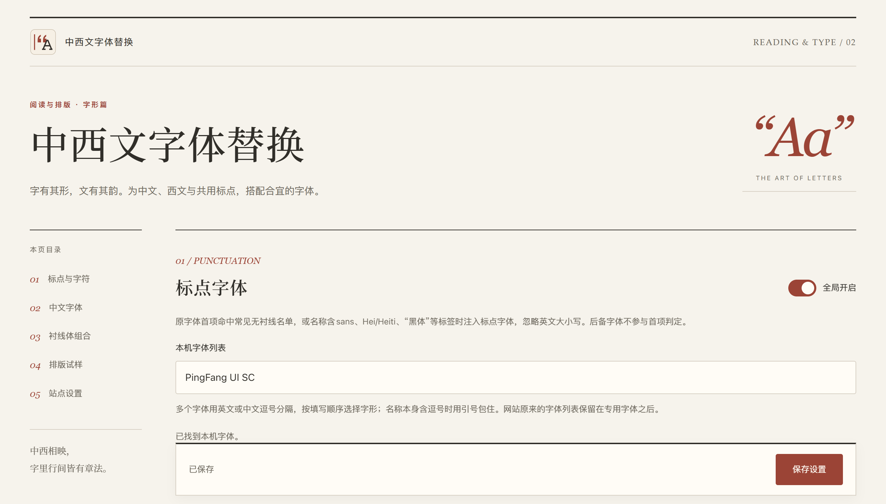

# 中西文字体替换 · 书页式前端

设计与实现日期：2026-10-15。

## 视觉语言

- 以现代书籍与文艺期刊为参考，使用暖纸白、墨黑和朱砂色，章节由细线与留白分隔。
- 标题使用本机衬线字体链：Iowan Old Style、Palatino Linotype、思源宋体/Noto Serif CJK SC、宋体。表单和提示使用界面字体，代码使用等宽字体；试排样张由实际设置决定字形。
- 浅色纸面为 `#f6f3ec`，正文为 `#302e29`，强调色为 `#9b4436`；暗色使用暖黑纸面与淡米色文字。
- 页面标识、标签页、工具栏和扩展管理页使用同一套书籍印记。SVG 为图标源文件，PNG 提供 16、32、48、128 像素。
- 页面使用本机字体和 CSS 绘制。交互过渡仅在操作时运行，减少动态效果设置会关闭过渡。

## 交互与适配

- 保存栏保持可达，状态以文字区分。输入、错误提示、键盘焦点与禁用状态有独立样式。
- 使用自绘控件与原生表单语义，支持键盘操作；折叠内容有展开/收起过渡。
- 窄屏将并排内容改为单列，长域名与说明正常换行；输入框可横向查看完整字体列表。
- 跟随浏览器明暗主题，并提供强制颜色模式下的控件边界。

## 页面结构

1. 标点与字符：标点字体、首项名单和可勾选的字符样张。
2. 中文字体：正文黑体与名单，宋体和楷体并排设置。
3. 衬线组合：中文、西文两组字体与共用字符来源。
4. 排版试样：分行标注无衬线正文、宋体、楷体、衬线组合与代码；代码使用 `Consolas`，可切换原字形对照。
5. 站点设置：域名、标点开关、本站字体和中文模式。

本机字体名称识别位于站点设置下方，默认折叠，按需展开使用。

桌面提供固定侧边目录，窄屏目录折行。宋体替换与衬线组合继续互斥；字体名称识别、检测结果与字体输入沿用原有数据接口。页面结构和样式分别维护于 `options.html`、`options.css`。

## 页面记录

截图由内置浏览器在本机设置页预览中保存，使用 PNG 格式。扩展 API 在该预览宿主中使用本地存储替身；真实扩展加载、配置及网页行为通过仓库现有 Chromium 回归检查。

- [浅色页面](options-light.png)
- [暗色页面](options-dark.png)
- [390 像素窄屏](options-mobile.png)
- [完整设置页](options-full.png)
- [Consolas 代码试样与底部折叠入口](options-tools.png)

